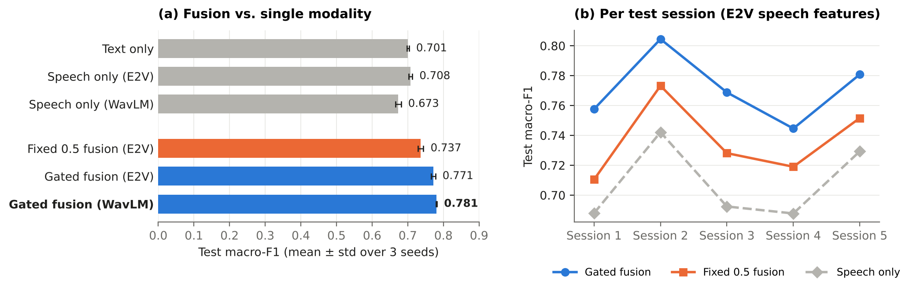

# Gated Multimodal Emotion Recognition in Conversation

**Why this matters.** Conversational systems, from voice assistants to tools for healthcare and customer support,
need to sense how a person feels in order to respond well. Text alone often misses it: "I'm fine" is neutral as text,
but spoken with a tense voice it can sound annoyed. Speech and text may agree in one turn and conflict in the next, so
combining them with fixed weights may be too rigid. Emotions also build up over a conversation rather than living in
a single utterance.

**Questions.** On IEMOCAP: does combining text and speech help, does a learned per-dimension gate combine them better
than a fixed average, and do the preceding turns of the conversation help?

**Findings:** combining text and speech improves macro-F1 by 6 to 7 points over the better single modality. A learned
gate beats a fixed 50/50 average in all 15 fold-seed pairs. Removing the conversation context costs about 6 points.

| Setting | Macro-F1 | UAR | Accuracy |
|---|---|---|---|
| Text only | 0.701 ± 0.003 | 0.704 | 0.699 |
| Speech only (emotion2vec) | 0.708 ± 0.005 | 0.711 | 0.707 |
| Speech only (WavLM) | 0.673 ± 0.008 | 0.676 | 0.670 |
| Fixed 0.5 fusion (emotion2vec) | 0.737 ± 0.007 | 0.740 | 0.735 |
| Gated fusion (emotion2vec) | 0.771 ± 0.006 | 0.776 | 0.769 |
| Gated fusion (WavLM) | **0.781 ± 0.001** | **0.782** | **0.777** |

Ablations of gated fusion (emotion2vec):

| Setting | Macro-F1 | UAR | Accuracy |
|---|---|---|---|
| Full model | 0.771 ± 0.006 | 0.776 | 0.769 |
| Current utterance only (no context) | 0.712 ± 0.011 | 0.712 | 0.709 |
| No gate penalty | 0.775 ± 0.006 | 0.778 | 0.773 |

*Leave-one-session-out on IEMOCAP, four classes. Mean ± standard deviation over three seeds. Bold: best in each
column.*

## Setup

- **Features:** frozen encoders, one vector per utterance. Text: BERT. Speech: emotion2vec or WavLM.
- **Model:** text and speech vectors are fused, then a GRU reads the target utterance and up to three preceding turns.
  Gated fusion learns a weight g per feature dimension: g · text + (1 − g) · speech. All models share the same GRU and
  classifier.
- **Evaluation:** each IEMOCAP session is held out once for testing. The epoch is chosen on validation dialogues from
  the training sessions; the test session is used once.

## What this means

Text and speech carry complementary cues, and a learned gate combines them better than equal weighting. Its average
weight, however, is about 0.5 for all four emotions: the gate mixes the two modalities differently across feature
dimensions, but it does not switch to one modality for a given emotion. The preceding turns add about as much as the second
modality, so a model that sees a single utterance leaves much of the signal unused.

## Limitations and next steps

- One dataset of acted dialogues, with human transcripts instead of speech recognition output.
- emotion2vec was pre-trained, without labels, on audio that includes IEMOCAP.
- The fixed baseline is an equal-weight average; concatenation was not tested.
- Next: transcripts from speech recognition, a concatenation baseline, and a second dataset such as MELD.

## Files

| File | Content |
|---|---|
| `notebooks/main-experiment.ipynb` | Full run on Kaggle: data checks, training, results |
| `src/` | Data loading, model, training and feature extraction |
| `tests/` | Checks for ordering, splits, padding and training |
| `results/`, `figures/` | Results from the notebook run and the script that draws the figure |

The notebook runs on Kaggle with a GPU (*Save & Run All*, about 70 minutes). IEMOCAP is available from
[USC SAIL](https://sail.usc.edu/iemocap/) on request and is not included.

## References

- C. Busso et al. *IEMOCAP: Interactive emotional dyadic motion capture database.* Language Resources and
  Evaluation 42, 335-359 (2008).
- J. Devlin, M.-W. Chang, K. Lee, K. Toutanova. *BERT: Pre-training of Deep Bidirectional Transformers for Language
  Understanding.* NAACL 2019.
- Z. Ma et al. *emotion2vec: Self-Supervised Pre-Training for Speech Emotion Representation.* Findings of ACL 2024.
- S. Chen et al. *WavLM: Large-Scale Self-Supervised Pre-Training for Full Stack Speech Processing.* IEEE Journal of
  Selected Topics in Signal Processing 16(6), 1505-1518 (2022).
